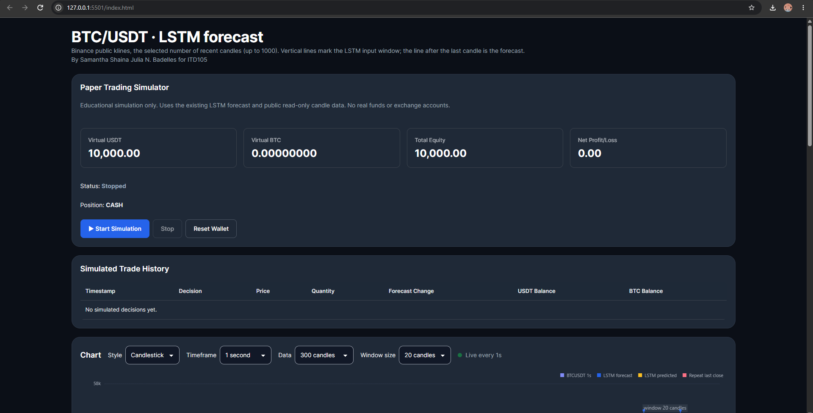
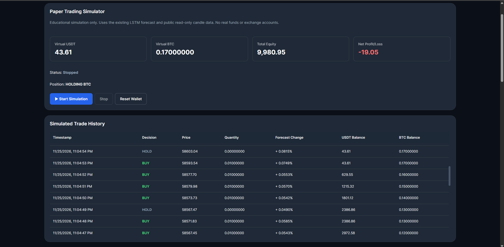
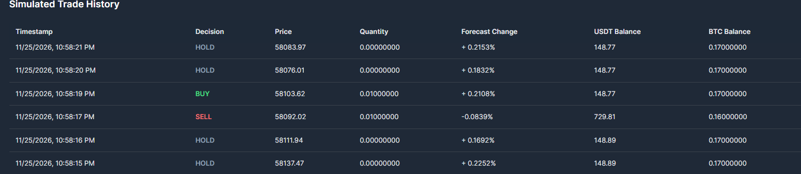
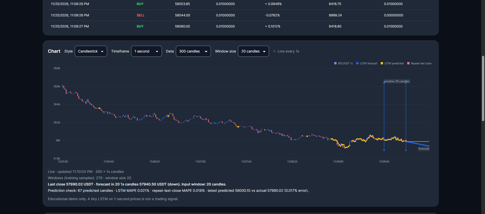
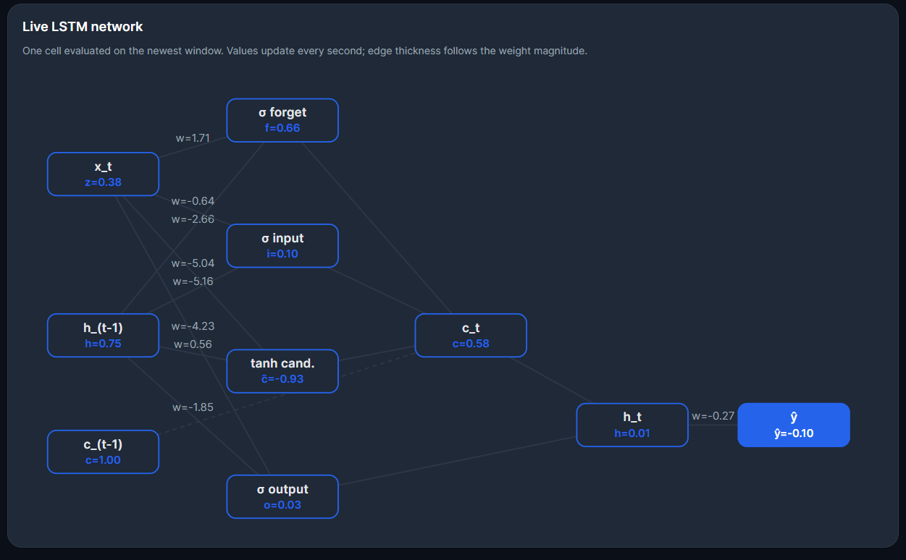
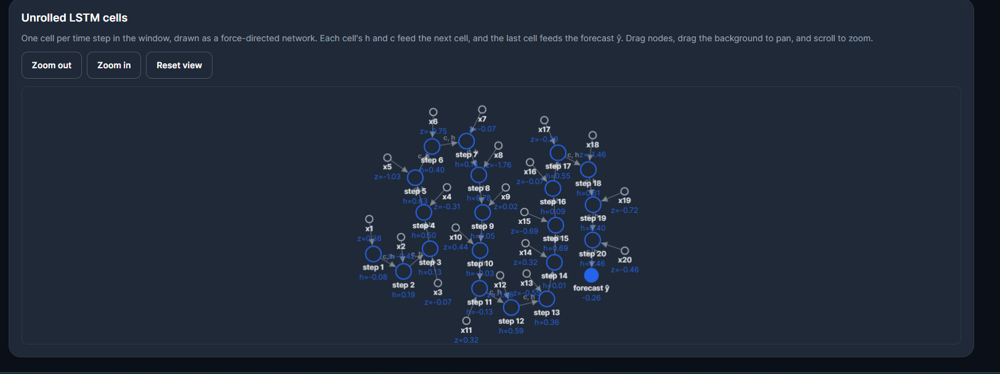
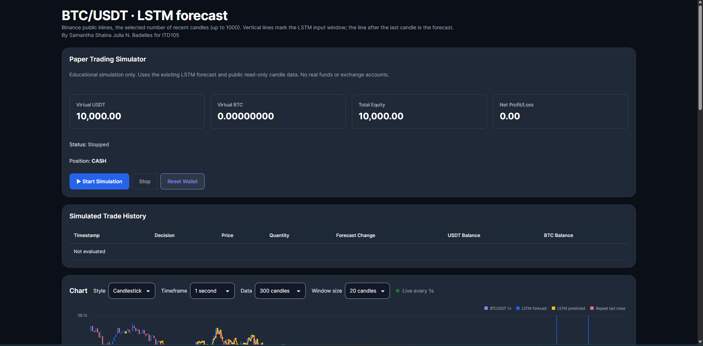

# Laboratory Activity: Building and Testing an LSTM Crypto Trading Bot (BTC/USDT)

**Name:** Samantha Shaina Julia N. Badelles
**Course Code:** ITD105
**Section:** IT4D

---

## 1. Project Overview

This laboratory activity focuses on extending the existing BZUI-LSTM-BTCUSDT forecasting application into an automated paper-trading simulator using a Long Short-Term Memory (LSTM) neural network.

The application processes historical BTC/USDT candlestick data retrieved from a public market data endpoint and generates future price forecasts. These forecasts are evaluated to determine simulated BUY, SELL, or HOLD decisions based on predefined percentage thresholds and the availability of virtual assets.

The original reference application was extended by implementing a JavaScript-based dummy account, automated simulated transaction execution, portfolio monitoring, simulation controls, and a decision history table.

This application is strictly intended for educational purposes. All transactions are simulated locally without real funds, cryptocurrency exchange accounts, external testnet accounts, or API credentials.

## 2. System Architecture

The application retains the original forecasting architecture while introducing additional functionalities for simulated account management and decision evaluation.

| File | Description |
|---|---|
| `index.html` | Contains the dashboard interface, virtual portfolio summary, simulation controls, decision history table, and forecasting visualizations. |
| `app.js` | Handles public candle data retrieval, LSTM training, forecasting, simulation integration, and interface updates. |
| `tiny-lstm.js` | Implements the LSTM neural network, including gate computations, forward propagation, and backpropagation through time. |
| `unroll-graph.js` | Provides an interactive visualization of the unrolled LSTM cells, hidden states, and cell states. |
| `trading-bot.js` | Manages the dummy account, virtual portfolio calculations, decision evaluation, simulated transactions, and decision history. |
| `screenshots/` | Contains the visual evidence collected during laboratory testing. |

### Forecasting Process

The application retrieves historical candlestick data and filters out candles that have not yet closed. Closing prices are transformed into percentage returns and normalized using z-scores before being processed by the LSTM model.

The normalized observations are organized into sliding windows that serve as training samples. The model is trained using backpropagation through time and generates a recursive forecast consisting of 20 future price observations.

The final predicted price is compared with the latest closed candle price for simulated decision evaluation.

## 3. Dummy Account and Simulation Strategy

### 3.1 In-Code JavaScript Dummy Account

The virtual account is implemented as a JavaScript state object initialized with 10,000.00 USDT and zero BTC.

The account maintains the following information:

- Virtual USDT balance
- Virtual BTC balance
- Total portfolio equity
- Net profit or loss
- Current holding position
- Simulation execution status
- Decision and transaction history
- Last processed candle

All account information is maintained locally within the application.

The total portfolio equity is calculated using:

**Portfolio Equity = USDT Balance + (BTC Balance × Current Price)**

The net profit or loss is calculated using:

**Net PnL = Total Portfolio Equity − Initial Virtual Balance**

### 3.2 LSTM Signal Generation

The expected percentage change is determined by comparing the final LSTM forecast with the latest closed candle price.

**Expected Percentage Change = [(Predicted Price − Current Price) / Current Price] × 100**

The simulated decision is classified according to the configured threshold and available virtual assets.

| Decision | Description |
|---|---|
| BUY | Represents a simulated purchase when the positive forecast condition and virtual balance requirements are satisfied. |
| SELL | Represents a simulated sale when the negative forecast condition and virtual holdings requirements are satisfied. |
| HOLD | Represents the absence of a simulated transaction when the forecast or available assets do not satisfy the corresponding conditions. |

The application does not force transactions to occur on every candle. HOLD is considered a valid decision and is retained in the decision history.

### 3.3 Simulated Transaction Execution

Simulated transactions modify the corresponding virtual USDT and BTC balances based on the latest closed candle price.

The application validates the available virtual assets before processing transactions to prevent negative balances. Portfolio equity and net PnL are recalculated using the latest available closing price.

A closed-candle tracking mechanism prevents repeated evaluation of the same candle.

Each evaluated decision is recorded in the history table with the following information:

- Timestamp
- Decision
- Price
- Quantity
- Forecast percentage change
- Updated virtual USDT balance
- Updated virtual BTC balance

HOLD decisions are recorded with a quantity of zero because no transaction is executed.

### 3.4 Simulation Controls

| Control | Function |
|---|---|
| Start Simulation | Enables simulated decision evaluation. |
| Stop | Stops new simulated transactions while preserving the existing balances and history. |
| Reset Wallet | Restores the initial dummy account balances and clears the decision history. |

## 4. Model Hyperparameters and Simulation Configuration

The following parameters were used during laboratory testing.

| Parameter | Selected Value |
|---|---|
| Symbol | BTCUSDT |
| Candlestick Interval | 1 second |
| Historical Candle Count | 300 candles |
| Lookback Window | 20 candles |
| Forecast Horizon | 20 steps |
| Epochs per Candle | 30 |
| Learning Rate | 0.005 |
| Initial Virtual USDT | 10,000.00 USDT |
| Initial Virtual BTC | 0 BTC |
| Signal Threshold | ±0.05% |
| Simulated Order Quantity | 0.01 BTC |
| Account Type | Local JavaScript dummy account |
| Execution Price | Latest closed candle price |

These parameters were used exclusively for the educational simulation and do not represent recommendations for actual cryptocurrency trading.

## 5. How to Run the Application

### Prerequisites

- Visual Studio Code
- Live Server extension
- Modern web browser
- Internet connection for public candlestick data and external libraries
- Git, if cloning through the terminal

### Installation and Execution

1. Clone or download this GitHub repository.
2. Extract the project folder if downloaded as a ZIP file.
3. Open the project directory in Visual Studio Code.
4. Install the Live Server extension if it is not yet installed.
5. Open the `index.html` file.
6. Right-click inside the editor and select **Open with Live Server**.
7. Allow the forecasting chart and LSTM visualizations to load.
8. Select the desired timeframe, historical candle count, and window size.
9. Click **Start Simulation** to begin the educational simulation.
10. Observe the virtual account and recorded decisions.
11. Click **Stop** to stop simulated transaction execution.
12. Click **Reset Wallet** to restore the initial dummy account configuration.

No additional database, exchange account, or API credentials are required.

## 6. Test Results and Screenshots

### 6.1 Initial Dummy Account and Portfolio Summary

*Figure 1. Initial configuration of the JavaScript dummy account.*

Before starting the simulation, the virtual account was initialized with 10,000.00 USDT and zero BTC. The total portfolio equity was equal to the initial balance, while the net profit or loss was zero.

The account was initially in the CASH position, and the simulation status was set to Stopped.

This demonstrates that the virtual wallet was properly initialized before conducting simulated transactions.

### 6.2 Updated Dummy Account and Portfolio Summary

*Figure 2. Updated virtual portfolio after simulated transactions.*

During testing, the generated LSTM forecasts resulted in several simulated transactions that modified the virtual USDT and BTC balances.

The following values were observed in the updated portfolio:

| Portfolio Component | Observed Value |
|---|---:|
| Initial Virtual USDT | 10,000.00 |
| Remaining Virtual USDT | 43.61 |
| Virtual BTC Holdings | 0.17000000 |
| Total Portfolio Equity | 9,980.95 |
| Net Profit/Loss | −19.05 |
| Current Position | HOLDING BTC |
| Simulation Status | Stopped |

The decrease in available virtual USDT indicates that a significant portion of the initial balance was converted into virtual BTC holdings during the simulation.

At the time of the screenshot, the portfolio recorded a net loss of 19.05 USDT. This demonstrates that the application correctly reflects changes in portfolio valuation rather than assuming that every simulated transaction produces a profit.

The screenshot also demonstrates that the wallet balances and recorded history remain available after stopping the simulation.

### 6.3 Simulated Trade Execution and Decision History

*Figure 3. Recorded BUY, SELL, and HOLD decisions during testing.*

The application successfully demonstrated all three simulated decision types during laboratory testing.

Selected entries from the recorded decision history are presented below.

| Timestamp | Decision | Price | Quantity | Forecast Change | USDT Balance | BTC Balance |
|---|---|---:|---:|---:|---:|---:|
| 10:58:15 PM | HOLD | 58,137.47 | 0.00 | +0.2252% | 148.89 | 0.17 |
| 10:58:16 PM | HOLD | 58,111.94 | 0.00 | +0.1692% | 148.89 | 0.17 |
| 10:58:17 PM | SELL | 58,092.02 | 0.01 | −0.0839% | 729.81 | 0.16 |
| 10:58:19 PM | BUY | 58,103.62 | 0.01 | +0.2108% | 148.77 | 0.17 |
| 10:58:20 PM | HOLD | 58,076.01 | 0.00 | +0.1832% | 148.77 | 0.17 |
| 10:58:21 PM | HOLD | 58,083.97 | 0.00 | +0.2153% | 148.77 | 0.17 |

At 10:58:17 PM, a negative forecast change resulted in a simulated SELL transaction. The virtual USDT balance increased from 148.89 to 729.81, while the virtual BTC holdings decreased from 0.17 to 0.16.

A subsequent positive forecast resulted in a simulated BUY transaction at 10:58:19 PM. The virtual USDT balance decreased to 148.77, while the virtual BTC holdings increased to 0.17.

Despite the succeeding positive forecasts, the application recorded HOLD decisions because the remaining virtual USDT balance was insufficient for another simulated transaction.

These observations demonstrate that the application responds to forecast changes while considering the availability of virtual assets. The decision history preserves BUY, SELL, and HOLD entries, including their corresponding timestamps and updated balances.

The results in this figure and the updated portfolio in Figure 2 represent different captured moments during laboratory testing.

### 6.4 LSTM Forecast Chart and Prediction Accuracy

*Figure 4. BTC/USDT candlestick chart and LSTM forecast overlay.*

The forecasting chart presents the historical BTC/USDT candlestick data, previous LSTM predictions, future forecast values, and the repeat-last-close baseline.

The application was configured with a one-second candlestick interval, 300 historical candles, and a lookback window of 20 candles.

The following forecasting results were observed:

| Metric | Observed Value |
|---|---:|
| Historical Candles | 300 |
| Training Samples | 279 |
| Input Window | 20 candles |
| Forecast Horizon | 20 candles |
| Latest Closing Price | 57,990.02 USDT |
| Forecasted Price | 57,940.50 USDT |
| Forecast Direction | Downward |
| Evaluated Predictions | 67 |
| LSTM MAPE | 0.021% |
| Repeat-Last-Close MAPE | 0.018% |

The LSTM generated a downward forecast during the captured observation.

However, the LSTM recorded a slightly higher Mean Absolute Percentage Error (MAPE) than the repeat-last-close baseline. This indicates that the LSTM did not outperform the simpler baseline during this particular evaluation period.

Although the forecasting functionality was successfully implemented, the observed results demonstrate that a neural network does not necessarily produce more accurate predictions than a simpler forecasting approach under all conditions.

### 6.5 Live LSTM Network Visualization

*Figure 5. Internal structure and gate activations of the LSTM network.*

The live network visualization illustrates how an individual LSTM cell processes the latest input sequence. It displays the normalized input, previous hidden state, previous cell state, forget gate, input gate, candidate state, output gate, updated cell state, and predicted output.

The visualization allows the internal behavior of the model to be observed beyond the forecast chart. It demonstrates how information is selectively retained, updated, and passed through the network during sequential processing.

### 6.6 Unrolled LSTM Cell Visualization

*Figure 6. Visualization of the LSTM cells unrolled across sequential time steps.*

The unrolled network visualization demonstrates how the hidden and cell states are propagated across consecutive time steps within the selected input window.

Each cell receives information from the previous time step and processes its corresponding normalized input. The resulting states are passed forward until the network produces its final prediction.

This visualization provides a clearer representation of the recurrent structure of the LSTM and its ability to process sequential observations.

### 6.7 Reset Wallet Verification

*Figure 7. Dummy account after executing the Reset Wallet functionality.*

After conducting the simulation, the Reset Wallet control was used to restore the initial account configuration.

The virtual USDT balance returned to 10,000.00, the virtual BTC balance returned to zero, and the net profit or loss was reset to zero. The current position returned to CASH, and the simulation status was set to Stopped.

The previously recorded decision history was also cleared.

This demonstrates that the reset mechanism functions correctly and allows the application to conduct repeated experiments using the same initial virtual account configuration.

## 7. Discussion and Limitations

The laboratory activity demonstrates the successful integration of an LSTM forecasting application with a locally maintained JavaScript dummy account.

During testing, the application demonstrated BUY, SELL, and HOLD decisions, automatic balance updates, virtual portfolio calculations, and decision history recording. The observed changes in virtual USDT and BTC balances were consistent with the corresponding simulated transactions.

The application also demonstrated the importance of validating available virtual assets. Several positive forecasts resulted in HOLD decisions because the remaining virtual USDT was insufficient for another simulated transaction.

The observed portfolio loss of 19.05 USDT further illustrates that predictive models do not guarantee positive outcomes. Similarly, the LSTM's MAPE of 0.021% was slightly higher than the baseline MAPE of 0.018%, indicating that the model did not outperform the simpler forecasting method during the captured evaluation.

The application has the following limitations:

- Short-interval price observations may contain considerable noise.
- LSTM predictions may vary between runs due to randomized model initialization and changing input data.
- The reference LSTM uses a relatively small neural network architecture.
- Simulated transaction execution does not account for exchange fees, slippage, or actual order-book conditions.
- The observed test results are limited to the recorded experimental periods and do not establish consistent forecasting accuracy.

These limitations emphasize that the application is an educational demonstration of sequential forecasting, automated decision evaluation, and virtual portfolio management rather than a system intended for actual financial transactions.

## 8. Conclusion

This laboratory activity successfully extended the BZUI-LSTM-BTCUSDT reference application into an educational paper-trading simulator with an in-code JavaScript dummy account.

The implemented functionalities include automated simulated decision evaluation, virtual transaction execution, portfolio equity and net PnL calculations, complete decision history recording, balance validation, and simulation controls.

The recorded experimental results demonstrate that the application can respond to changing LSTM forecasts and update its virtual account accordingly. The observed BUY, SELL, and HOLD decisions, together with the portfolio and reset verification screenshots, provide evidence of the implemented functionalities.

The activity also provided a practical understanding of LSTM-based sequential forecasting, state management, software integration, and experimental evaluation. Furthermore, it highlighted the limitations of predictive models and the importance of comparing model performance against a baseline.

All testing was conducted using simulated assets without real funds, exchange accounts, or API credentials.

## 9. Reference and Acknowledgment

This project is based on the original BZUI-LSTM-BTCUSDT reference codebase provided by MSU-IIT.

**Reference Repository:**  
https://github.com/msuiit-ph/BZUI-LSTM-BTCUSDT

The original LSTM implementation and forecasting visualizations were retained and extended to satisfy the laboratory activity requirements.

The original project license is included in the `LICENSE` file.